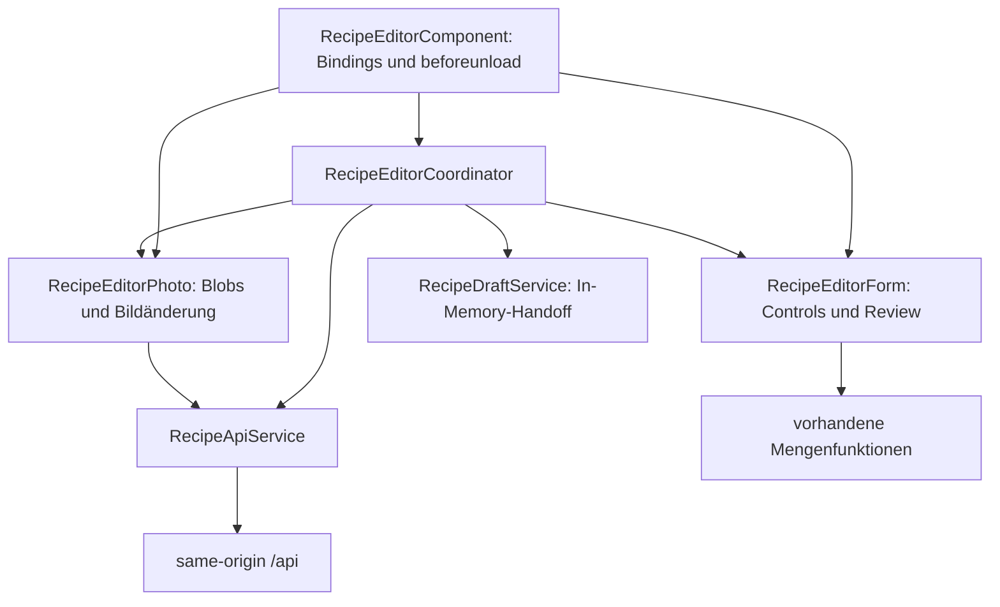
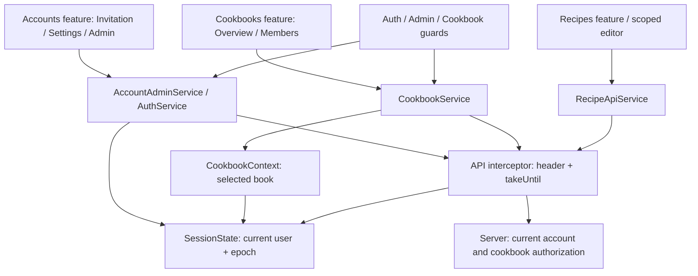

# Recipoke-Frontend: Architektur und Zusammenarbeit

## Entwurfsentscheidung

Das Frontend bleibt eine Angular-Anwendung mit lazy geladenen NgModules, typisierten Reactive Forms, Signals und RxJS. Der vorhandene Refactoring-Aufbau wird um einladungsbasierte Konten und geteilte Cookbooks ergänzt. Es gibt weiterhin keinen globalen State Store oder persistierte Entwürfe. Neue Accounts-/Cookbooks-Features ergänzen die bisherigen Recipe-Komponenten; Mengenverhalten, Bildretry und Importgrenzen bleiben erhalten.

Die systemweiten Entscheidungen stehen im [Backend-Architekturüberblick](https://github.com/Snegge/RecipeAtlas/blob/feature/accounts-and-cookbooks/docs/architecture/README.md) und in den dortigen ADRs, insbesondere 009–012 für Identity, Einladungen, Cookbook-Autorisierung und Upgrade. Der Ansatz ist ein featureorganisierter Monolith mit unabhängiger Backend-Domain, keine strikte Clean Architecture.

## Verantwortung und Zustand



Alle drei Editor-Provider werden im `providers`-Array des Components registriert. Es gibt keine zweite Zustandskopie im Component und keinen root-scoped Editor-Singleton. Aliase halten Referenzen auf dieselben Signals und FormControls. Zwei gleichzeitig erzeugte Editoren besitzen getrennte Formular-, Review- und Fotodaten.

`RecipeEditorCoordinator` besitzt Laden, Rezept-ID, Busy-/Fehlerzustand, Save-Reihenfolge und Navigation. `RecipeEditorForm` besitzt Validierung, geordnete Zutaten/Schritte, Mengenkanonisierung, Review-Metadaten und die Abbildung zum Command. `RecipeEditorPhoto` besitzt vorbereitete Blobs, Preview-URLs, Bildfehler und die noch ausstehende Bildänderung. Der Component enthält nur UI-Delegation und den bisherigen Browser-Unload-Schutz.

Nach erfolgreichem Anlegen wird die ID vor dem Bildrequest übernommen. Ein Bildfehler erhält diesen Zustand; ein erneutes Speichern aktualisiert dasselbe Rezept und wiederholt den Upload. Kein zweites Rezept wird erzeugt. Das Formular bleibt während der Speicherung gesperrt. Nach Zerstörung eines Editors darf eine verspätete Save-Antwort keine Navigation auslösen. Object URLs werden beim Zerstören freigegeben. Der gemeinsame API-Interceptor bricht RxJS-Requests bei Sessionwechsel ab; Epoch-Prüfungen verhindern zusätzlich verspätete Promise-Fortsetzungen. RecipeEditorCoordinator erhält Form-/Foto-Eingaben bei einem 403/404 und blockiert weitere Saves mit verständlichem Hinweis. Expliziter Logout/Accountwechsel löscht diese Daten; eine abgelaufene Sitzung allein verwirft keine ungesicherten Texte.

Der Importdialog verwendet weiterhin RxJS-Cancellation und übergibt den Entwurf über den speicherinternen `RecipeDraftService`. Ein Refresh kann den Entwurf verlieren; die Persistenz über Refresh ist ausdrücklich nicht implementiert.

## Verträge und Ownership

Das Backend ist maßgeblich für HTTP-Verträge, Mengendefinitionen und die gemeinsamen Fixtures. Frontend-Formmodelle bleiben von Transportinterfaces getrennt. Bei einer gemeinsamen Änderung werden beide Repository-Diffs und beide Commits koordiniert; die Projektstruktur erzwingt diese Abstimmung nicht automatisch. Diese Kommunikationsgrenze ist die relevante Anwendung von Conway's law.

`contracts/recipoke.openapi.json` ist ein generierter Backend-Snapshot. `scripts/check-contracts.mjs` verwendet den bereits vorhandenen TypeScript-Compiler, um bestehende Transportinterfaces auf Eigenschaften, Nullability und Typen zu prüfen. Er kontrolliert außerdem verwendete API-Routen, den bestehenden Schreibheader und Fingerprints der Mengenfixtures. Eine gezielt falsche Mengenart wird als negative Probe zurückgewiesen.

Ein zusätzlicher TypeScript-Generator wurde vorerst abgelehnt: die überschaubaren Interfaces lassen sich ohne weitere Generator-Toolchain prüfen. Für Commands sind strengere Frontendtypen erlaubt als nullable Eingabeparameter, die das Backend fachlich validiert. Formularzustand wird nicht aus OpenAPI generiert.

## Lokaler Ablauf und Synchronisation

Node 24.19.0 erfüllt die bestehende `engines`-Vorgabe. Von diesem Repository aus:

```sh
npm ci
npm run check:contracts
npm test
npm run build
npm start
```

Die Befehle benötigen lokal keine Cloud-Datei `/workspace/.setup/env.sh`. Aus dem Backend-Checkout, wenn ein Vertrag bewusst geändert wurde:

```sh
dotnet build
python3 scripts/export_openapi.py
python3 scripts/sync_frontend_contracts.py ../RecipeAtlasFrontend
python3 tests/check_shared_contracts.py ../RecipeAtlasFrontend
python3 scripts/sync_frontend_contracts.py ../RecipeAtlasFrontend --check
```

`../RecipeAtlasFrontend` ist nur ein Beispiel für direkt benachbarte Checkouts. Bei einer anderen Verzeichnisstruktur muss der tatsächliche, gegebenenfalls in Anführungszeichen gesetzte absolute Pfad zum Frontend-Verzeichnis mit `package.json` verwendet werden.

Danach im Frontend `npm run check:contracts`, `npm test` und `npm run build` ausführen und beide Diffs prüfen. Autoritative Dateien sind `backend/Recipoke.Domain/Quantities/MeasurementUnits.json` und `tests/fixtures/quantity-cases.json` im Backend. Kopien werden nicht unabhängig fachlich weiterentwickelt. Der Sync überschreibt semantisch identische Fixtures nicht nur wegen Formatierung.

Frontend-CI nutzt den eigenen Snapshot und benötigt keinen Zugriff auf ein privates Backend. Sie erkennt deshalb nicht selbstständig einen neueren, noch nicht synchronisierten Backend-Stand. Dafür bleibt der explizite Cross-Repository-Check erforderlich. Die Actions besitzen nur `contents: read`; es werden keine privaten Inhalte oder Credentials als Artefakte abgelegt.

## Prinzipien und Alternativen

SRP trennt Formular-, Foto- und Ablaufzustand. DRY vermeidet doppelte aktive Editorzustände; notwendige Clientvalidierung bleibt bestehen. YAGNI spricht gegen einen globalen Store, universelle Facades oder neue Persistenz. Die Domain-Mengenregeln haben dieselben Fixtures wie das Frontend; akzeptierte Varianten wie Dezimalkomma und Brüche werden normalisiert, fehlerhafte Mengen und ungeklärte Importangaben bleiben sichtbar. OCP/LSP/ISP/DIP betreffen vor allem die Backend-Providerverträge; die kleine Editoraufteilung benötigt keine Schnittstelle pro Klasse.

## Verifikation und Grenzen

Baseline: Commit `9cdc6e03accd8765cfd49394f152ebf26bf71d14`, sauberer `main`, 134 Tests und erfolgreicher Produktionsbuild. Nach der Aufteilung bestehen 137 Tests, darunter Instanzisolation und verspätete Save-Antwort nach Component-Zerstörung. Vorhandene Tests prüfen Formbindung, Mengen, Review, Bildretry, Importdialog und Navigation. Mobile Templates/Styles wurden nicht geändert; eine neue visuelle Browserprüfung wurde nicht durchgeführt. Live-Gemini und reale Social-Plattformen sind keine Voraussetzung der normalen Tests.

Die bisherigen Refactoring-Ergebnisse sind historische Nachweise. Für diese Erweiterung wurde von sauberem `feature/accounts-and-cookbooks` bei `add4bc4a3ff57cf34d95b42b8e0298670e576119` gestartet: 137 Tests/Build erfolgreich. Jetzt prüfen 166 Tests und 146 Transportchecks die bestehenden und neuen Verantwortlichkeiten. Browser-/TLS-/Container-Verifikation wird damit nicht behauptet. `X-RecipeAtlas`, Mengen-/Rezeptfelder und Importvertrag bleiben gleich; neuer Cookie und Cookbook-Routen sind ausdrücklich notwendige Breaking Changes. Offline, persistierte Drafts, PWA und allgemeine Konflikterkennung bleiben vertagt.

## Konten-, Cookbook- und Sitzungsgrenzen



`SessionState` besitzt genau eine CurrentUser-Quelle, die `AuthService` referenziert. Logout/Loginwechsel erhöht eine Generation, leert Import-Handoff und sendet ein Ereignis. Cookbook-Auswahl und lokale Rezept-/Admin-Listen löschen ihre Daten. Der Interceptor beendet alte Requests; Tests prüfen auch den schwierigeren Fall, dass eine HTTP-Antwort bereits abgeschlossen ist, ihre Promise-Fortsetzung aber erst nach dem Benutzerwechsel läuft. Admin-Invite-Links dürfen so nicht wieder erscheinen. Es gibt keine Benutzer-/Tokenpersistenz in localStorage.

`CookbookContext` besitzt nur die ausgewählte Antwort und daraus abgeleitete UI-Rechte. Es gibt keine zweite Rollenquelle im Editor. Guards laden die aktuelle Book-Antwort und führen bei verlorener Berechtigung zur Übersicht mit Hinweis. Recipe-API-Methoden benötigen eine explizite Cookbook-ID; URL und Backend prüfen die Zuordnung. Viewer sehen keine Schreibaktionen, Editor nur Rezeptaktionen, Owner zusätzlich Member-Verwaltung. Der Admin-Navigationspunkt folgt der separaten globalen Fähigkeit, nicht einer Cookbook-Rolle.

### Mobile Bedienung und Invitation-Secrets

Neue Seiten verwenden umbruchfähige Karten und Forms statt Desktop-Tabellen, gelabelte Eingaben, Status-/Fehlertexte und mindestens 44px hohe Aktionsziele. Die Acceptance-Seite liest das Fragment, entfernt es mit `Location.replaceState` und sendet den Secret nur in den notwendigen POST-Body. Validierung allein verbraucht nichts; ein fehlgeschlagener Username-Submit erhält die Felder. Nach Erfolg werden Passwort/Token gelöscht. Ein Referrer-Meta-Tag und die serverseitige Policy ergänzen das Fragment. Kein Analytics-/Drittinhalt wird eingebunden.

### Entscheidungen und Grenzen

SRP trennt Account-Lebenszyklus, Book-Verwaltung und Recipe-Editor. DRY zentralisiert Session-/Book-Anzeigestate; Serverautorität wird nicht durch Clientprüfungen ersetzt. YAGNI verhindert einen globalen Store oder eine neue universelle Facade. Es gibt keine Schnittstelle für jede HTTP-Serviceklasse. Die kleine Generation plus Cancellation ist konkret durch Benutzerwechsel motiviert, keine Offline- oder Sync-Infrastruktur. Conway betrifft die koordinierte Auslieferung der beiden Repository-Verträge. Großzügige Eingabetoleranz ist auf dokumentierte Username-/Mengen-Normalisierung beschränkt; Rollen werden nicht erraten.

Die Backend-ADRs enthalten Kontext, Alternativen, Konsequenzen, Testnachweise und Neubewertungskriterien. [Runbook und Zwei-Benutzer-Demo](https://github.com/Snegge/RecipeAtlas/blob/feature/accounts-and-cookbooks/docs/accounts-and-cookbooks.md) beschreiben Bootstrap, Migration, Recovery und Berechtigungsmatrix. Diese Autorisierungsgrenze kann später Shopping Lists/Cooking Sessions tragen; die Features selbst sind nicht implementiert.

Cookbook-/Recipe-ID-Wechsel erzeugen eine neue Page-Instanz (`CookbookRouteReuseStrategy`) und aktivieren den bestehenden Unsaved-Guard auch zwischen zwei Editor-URLs. Ein Router-Test belegt Abbruch bei abgelehntem Discard und frischen Formzustand nach bestätigter Navigation.

## Automatisierter echter Browser-Smoke

`node tests/browser-accounts-smoke.mjs /absoluter/backend/root /pfad/zu/chromium` verwendet Node-WebSocket/CDP ohne zusätzliche npm-Testframeworks. Es startet gebaute Backend-/Frontend-Instanzen mit temporärer SQLite-Datenbank, zufälligem Passwort und zwei isolierten Browserkontexten. 21 Prüfungen bestanden mit Chromium 154 bei 320px/1280px: Einladung/Anmeldung, Owner-Rename/Sharing, Viewer-/Editor-Controls, verweigerter Save mit erhaltenen Texten, Unsaved-Dialog, Logout, Deaktivierung/Reaktivierung, Passwortwechsel, Revoke und neues Cookbook. Horizontaler Overflow wird gemessen; eine umfassende menschliche visuelle Prüfung wird nicht behauptet. Browserprofile, Prozesse und synthetische Daten werden anschließend entfernt. Der Backend muss vorher gebaut sein und dotnet im PATH liegen.

Dieser optionale Test benötigt beide lokalen Repositories und vorhandenes Chromium. Die normale Frontend-CI bleibt eigenständig und führt alle 166 jsdom-Tests aus; sie benötigt keine privaten Backend-Zugangsdaten. Container-/TLS-/Live-Provider-Verifikation bleibt separat.
