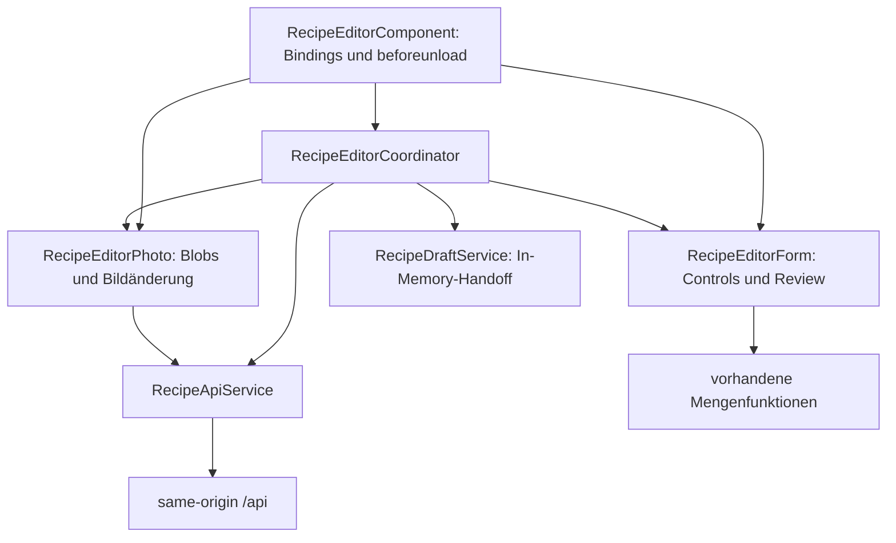

# Recipoke-Frontend: Architektur und Zusammenarbeit

## Entwurfsentscheidung

Das Frontend bleibt eine Angular-Anwendung mit lazy geladenen NgModules, typisierten Reactive Forms, Signals und RxJS. Dieses Refactoring führt weder einen globalen State Store noch persistierte Entwürfe oder neue UI-Funktionen ein. Layout, Vorlagen, Routen, Mengenverhalten und vorhandene Kindkomponenten bleiben erhalten.

Die systemweiten Entscheidungen stehen im [Backend-Architekturüberblick](https://github.com/Snegge/RecipeAtlas/blob/main/docs/architecture/README.md) und in den dortigen acht ADRs. Der Ansatz ist ein featureorganisierter Monolith mit unabhängiger Backend-Domain, keine strikte Clean Architecture.

## Verantwortung und Zustand



Alle drei Editor-Provider werden im `providers`-Array des Components registriert. Es gibt keine zweite Zustandskopie im Component und keinen root-scoped Editor-Singleton. Aliase halten Referenzen auf dieselben Signals und FormControls. Zwei gleichzeitig erzeugte Editoren besitzen getrennte Formular-, Review- und Fotodaten.

`RecipeEditorCoordinator` besitzt Laden, Rezept-ID, Busy-/Fehlerzustand, Save-Reihenfolge und Navigation. `RecipeEditorForm` besitzt Validierung, geordnete Zutaten/Schritte, Mengenkanonisierung, Review-Metadaten und die Abbildung zum Command. `RecipeEditorPhoto` besitzt vorbereitete Blobs, Preview-URLs, Bildfehler und die noch ausstehende Bildänderung. Der Component enthält nur UI-Delegation und den bisherigen Browser-Unload-Schutz.

Nach erfolgreichem Anlegen wird die ID vor dem Bildrequest übernommen. Ein Bildfehler erhält diesen Zustand; ein erneutes Speichern aktualisiert dasselbe Rezept und wiederholt den Upload. Kein zweites Rezept wird erzeugt. Das Formular bleibt während der Speicherung gesperrt. Nach Zerstörung eines Editors darf eine verspätete Save-Antwort keine Navigation auslösen. Object URLs werden beim Zerstören freigegeben. Bestehende Promise-basierte Rezeptrequests wurden nicht in eine neue Request-Abbrucharchitektur umgebaut.

Der Importdialog verwendet weiterhin RxJS-Cancellation und übergibt den Entwurf über den speicherinternen `RecipeDraftService`. Ein Refresh kann den Entwurf verlieren; die Persistenz über Refresh ist ausdrücklich nicht implementiert.

## Verträge und Ownership

Das Backend ist maßgeblich für HTTP-Verträge, Mengendefinitionen und die gemeinsamen Fixtures. Frontend-Formmodelle bleiben von Transportinterfaces getrennt. Bei einer gemeinsamen Änderung werden beide Repository-Diffs und beide Commits koordiniert; die Projektstruktur erzwingt diese Abstimmung nicht automatisch. Diese Kommunikationsgrenze ist die relevante Anwendung von Conway's law.

`contracts/recipoke.openapi.json` ist ein generierter Backend-Snapshot. `scripts/check-contracts.mjs` verwendet den bereits vorhandenen TypeScript-Compiler, um bestehende Transportinterfaces auf Eigenschaften, Nullability und Typen zu prüfen. Er kontrolliert außerdem verwendete API-Routen, den bestehenden Schreibheader und Fingerprints der Mengenfixtures. Eine gezielt falsche Mengenart wird als negative Probe zurückgewiesen.

Ein zusätzlicher TypeScript-Generator wurde vorerst abgelehnt: die überschaubaren Interfaces lassen sich ohne weitere Generator-Toolchain prüfen. Für Commands sind strengere Frontendtypen erlaubt als nullable Eingabeparameter, die das Backend fachlich validiert. Formularzustand wird nicht aus OpenAPI generiert.

## Lokaler Ablauf und Synchronisation

Node 24.19.0 erfüllt die bestehende `engines`-Vorgabe. Von diesem Repository aus:

```sh
npm ci
npm run check:contracts
npm test
npm run build
npm start
```

Aus dem Backend-Checkout, wenn ein Vertrag bewusst geändert wurde:

```sh
dotnet build
python3 scripts/export_openapi.py
python3 scripts/sync_frontend_contracts.py ../RecipeAtlasFrontend
python3 tests/check_shared_contracts.py ../RecipeAtlasFrontend
python3 scripts/sync_frontend_contracts.py ../RecipeAtlasFrontend --check
```

Danach im Frontend `npm run check:contracts`, `npm test` und `npm run build` ausführen und beide Diffs prüfen. Autoritative Dateien sind `backend/Recipoke.Domain/Quantities/MeasurementUnits.json` und `tests/fixtures/quantity-cases.json` im Backend. Kopien werden nicht unabhängig fachlich weiterentwickelt. Der Sync überschreibt semantisch identische Fixtures nicht nur wegen Formatierung.

Frontend-CI nutzt den eigenen Snapshot und benötigt keinen Zugriff auf ein privates Backend. Sie erkennt deshalb nicht selbstständig einen neueren, noch nicht synchronisierten Backend-Stand. Dafür bleibt der explizite Cross-Repository-Check erforderlich. Die Actions besitzen nur `contents: read`; es werden keine privaten Inhalte oder Credentials als Artefakte abgelegt.

## Prinzipien und Alternativen

SRP trennt Formular-, Foto- und Ablaufzustand. DRY vermeidet doppelte aktive Editorzustände; notwendige Clientvalidierung bleibt bestehen. YAGNI spricht gegen einen globalen Store, universelle Facades oder neue Persistenz. Die Domain-Mengenregeln haben dieselben Fixtures wie das Frontend; akzeptierte Varianten wie Dezimalkomma und Brüche werden normalisiert, fehlerhafte Mengen und ungeklärte Importangaben bleiben sichtbar. OCP/LSP/ISP/DIP betreffen vor allem die Backend-Providerverträge; die kleine Editoraufteilung benötigt keine Schnittstelle pro Klasse.

## Verifikation und Grenzen

Baseline: Commit `9cdc6e03accd8765cfd49394f152ebf26bf71d14`, sauberer `main`, 134 Tests und erfolgreicher Produktionsbuild. Nach der Aufteilung bestehen 137 Tests, darunter Instanzisolation und verspätete Save-Antwort nach Component-Zerstörung. Vorhandene Tests prüfen Formbindung, Mengen, Review, Bildretry, Importdialog und Navigation. Mobile Templates/Styles wurden nicht geändert; eine neue visuelle Browserprüfung wurde nicht durchgeführt. Live-Gemini und reale Social-Plattformen sind keine Voraussetzung der normalen Tests.

Die bestehenden Identitäten `X-RecipeAtlas`, `RecipeAtlas.Session`, API-Routen und JSON-Felder bleiben gleich. Neue Konten, Offline-Funktionen, persistierte Drafts, PWA, Concurrency-Tokens und ein neuer globaler Store sind nicht Teil dieses Standes.
