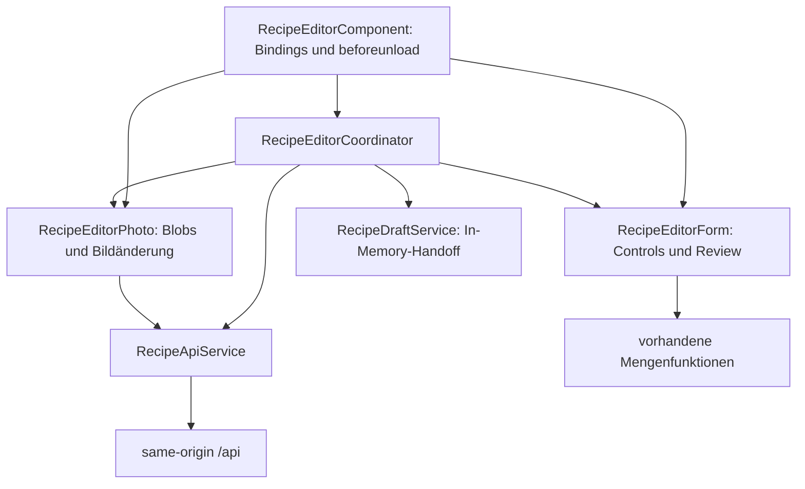
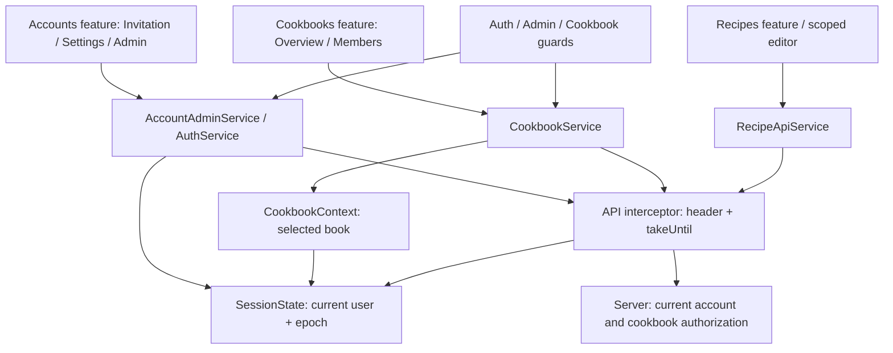
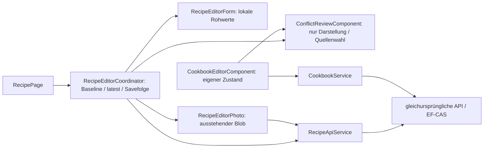

# Recipoke-Frontend: Architektur und Zusammenarbeit

## Entwurfsentscheidung

Das Frontend bleibt eine Angular-Anwendung mit lazy geladenen NgModules, typisierten Reactive Forms, Signals und RxJS. Der vorhandene Refactoring-Aufbau wird um einladungsbasierte Konten und geteilte Cookbooks ergänzt. Es gibt weiterhin keinen globalen State Store oder persistierte Entwürfe. Neue Accounts-/Cookbooks-Features ergänzen die bisherigen Recipe-Komponenten; Mengenverhalten, Bildretry und Importgrenzen bleiben erhalten.

Die systemweiten Entscheidungen stehen im [Backend-Architekturüberblick](https://github.com/Snegge/RecipeAtlas/blob/feature/shared-editing/docs/architecture/README.md) und in den dortigen ADRs, insbesondere 009–013 für Identity, Einladungen, Cookbook-Autorisierung und Upgrade. Der Ansatz ist ein featureorganisierter Monolith mit unabhängiger Backend-Domain, keine strikte Clean Architecture.

## Verantwortung und Zustand



Alle drei Editor-Provider werden im `providers`-Array des Components registriert. Es gibt keine zweite Zustandskopie im Component und keinen root-scoped Editor-Singleton. Aliase halten Referenzen auf dieselben Signals und FormControls. Zwei gleichzeitig erzeugte Editoren besitzen getrennte Formular-, Review- und Fotodaten.

`RecipeEditorCoordinator` besitzt Laden, Rezept-ID, Busy-/Fehlerzustand, Save-Reihenfolge und Navigation. `RecipeEditorForm` besitzt Validierung, geordnete Zutaten/Schritte, Mengenkanonisierung, Review-Metadaten und die Abbildung zum Command. `RecipeEditorPhoto` besitzt vorbereitete Blobs, Preview-URLs, Bildfehler und die noch ausstehende Bildänderung. Der Component enthält nur UI-Delegation und den bisherigen Browser-Unload-Schutz.

Nach erfolgreichem Anlegen wird die ID vor dem Bildrequest übernommen. Ein Bildfehler erhält diesen Zustand; ein erneutes Speichern ohne weitere Textänderung wiederholt nur den Upload mit der bereits zurückgegebenen neuen Version. Kein zweites Rezept wird erzeugt. Das Formular bleibt während der Speicherung gesperrt. Nach Zerstörung eines Editors darf eine verspätete Save-Antwort keine Navigation auslösen. Object URLs werden beim Zerstören freigegeben. Der gemeinsame API-Interceptor bricht RxJS-Requests bei Sessionwechsel ab; Epoch-Prüfungen verhindern zusätzlich verspätete Promise-Fortsetzungen. RecipeEditorCoordinator erhält Form-/Foto-Eingaben bei einem 403/404 und blockiert weitere Saves mit verständlichem Hinweis. Expliziter Logout/Accountwechsel löscht diese Daten; eine abgelaufene Sitzung allein verwirft keine ungesicherten Texte.

Der Importdialog verwendet weiterhin RxJS-Cancellation und übergibt den Entwurf über den speicherinternen `RecipeDraftService`. Ein Refresh kann den Entwurf verlieren; die Persistenz über Refresh ist ausdrücklich nicht implementiert.

## Verträge und Ownership

Das Backend ist maßgeblich für HTTP-Verträge, Mengendefinitionen und die gemeinsamen Fixtures. Frontend-Formmodelle bleiben von Transportinterfaces getrennt. Bei einer gemeinsamen Änderung werden beide Repository-Diffs und beide Commits koordiniert; die Projektstruktur erzwingt diese Abstimmung nicht automatisch. Diese Kommunikationsgrenze ist die relevante Anwendung von Conway's law.

`contracts/recipoke.openapi.json` ist ein generierter Backend-Snapshot. `scripts/check-contracts.mjs` verwendet den bereits vorhandenen TypeScript-Compiler, um bestehende Transportinterfaces auf Eigenschaften, Nullability und Typen zu prüfen. Er kontrolliert außerdem verwendete API-Routen, den bestehenden Schreibheader und Fingerprints der Mengenfixtures. Eine gezielt falsche Mengenart wird als negative Probe zurückgewiesen.

Ein zusätzlicher TypeScript-Generator wurde vorerst abgelehnt: die überschaubaren Interfaces lassen sich ohne weitere Generator-Toolchain prüfen. Für Commands sind strengere Frontendtypen erlaubt als nullable Eingabeparameter, die das Backend fachlich validiert. Formularzustand wird nicht aus OpenAPI generiert.

## Lokaler Ablauf und Synchronisation

Node 24.19.0 erfüllt die bestehende `engines`-Vorgabe. Von diesem Repository aus:

```sh
npm ci
npm run check:contracts
npm test
npm run build
npm start
```

Die Befehle benötigen lokal keine Cloud-Datei `/workspace/.setup/env.sh`. Aus dem Backend-Checkout, wenn ein Vertrag bewusst geändert wurde:

```sh
dotnet build
python3 scripts/export_openapi.py
python3 scripts/sync_frontend_contracts.py ../RecipeAtlasFrontend
python3 tests/check_shared_contracts.py ../RecipeAtlasFrontend
python3 scripts/sync_frontend_contracts.py ../RecipeAtlasFrontend --check
```

`../RecipeAtlasFrontend` ist nur ein Beispiel für direkt benachbarte Checkouts. Bei einer anderen Verzeichnisstruktur muss der tatsächliche, gegebenenfalls in Anführungszeichen gesetzte absolute Pfad zum Frontend-Verzeichnis mit `package.json` verwendet werden.

Danach im Frontend `npm run check:contracts`, `npm test` und `npm run build` ausführen und beide Diffs prüfen. Autoritative Dateien sind `backend/Recipoke.Domain/Quantities/MeasurementUnits.json` und `tests/fixtures/quantity-cases.json` im Backend. Kopien werden nicht unabhängig fachlich weiterentwickelt. Der Sync überschreibt semantisch identische Fixtures nicht nur wegen Formatierung.

Frontend-CI nutzt den eigenen Snapshot und benötigt keinen Zugriff auf ein privates Backend. Sie erkennt deshalb nicht selbstständig einen neueren, noch nicht synchronisierten Backend-Stand. Dafür bleibt der explizite Cross-Repository-Check erforderlich. Die Actions besitzen nur `contents: read`; es werden keine privaten Inhalte oder Credentials als Artefakte abgelegt.

## Prinzipien und Alternativen

SRP trennt Formular-, Foto- und Ablaufzustand. DRY vermeidet doppelte aktive Editorzustände; notwendige Clientvalidierung bleibt bestehen. YAGNI spricht gegen einen globalen Store, universelle Facades oder neue Persistenz. Die Domain-Mengenregeln haben dieselben Fixtures wie das Frontend; akzeptierte Varianten wie Dezimalkomma und Brüche werden normalisiert, fehlerhafte Mengen und ungeklärte Importangaben bleiben sichtbar. OCP/LSP/ISP/DIP betreffen vor allem die Backend-Providerverträge; die kleine Editoraufteilung benötigt keine Schnittstelle pro Klasse.

## Verifikation und Grenzen

Baseline: Commit `9cdc6e03accd8765cfd49394f152ebf26bf71d14`, sauberer `main`, 134 Tests und erfolgreicher Produktionsbuild. Nach der Aufteilung bestehen 137 Tests, darunter Instanzisolation und verspätete Save-Antwort nach Component-Zerstörung. Vorhandene Tests prüfen Formbindung, Mengen, Review, Bildretry, Importdialog und Navigation. Mobile Templates/Styles wurden nicht geändert; eine neue visuelle Browserprüfung wurde nicht durchgeführt. Live-Gemini und reale Social-Plattformen sind keine Voraussetzung der normalen Tests.

Die bisherigen Refactoring-Ergebnisse sind historische Nachweise. Für diese Erweiterung wurde von sauberem `feature/accounts-and-cookbooks` bei `add4bc4a3ff57cf34d95b42b8e0298670e576119` gestartet: 137 Tests/Build erfolgreich. Am Abschluss der ersten Account-Erweiterung prüften 166 Tests und 146 Transportchecks die bestehenden und neuen Verantwortlichkeiten. Browser-/TLS-/Container-Verifikation wird damit nicht behauptet. `X-RecipeAtlas`, Mengen-/Rezeptfelder und Importvertrag bleiben gleich; neuer Cookie und Cookbook-Routen sind ausdrücklich notwendige Breaking Changes. Offline, persistierte Drafts, PWA und allgemeine Konflikterkennung bleiben vertagt.

## Konten-, Cookbook- und Sitzungsgrenzen



`SessionState` besitzt genau eine CurrentUser-Quelle, die `AuthService` referenziert. Logout/Loginwechsel erhöht eine Generation, leert Import-Handoff und sendet ein Ereignis. Cookbook-Auswahl und lokale Rezept-/Admin-Listen löschen ihre Daten. Der Interceptor beendet alte Requests; Tests prüfen auch den schwierigeren Fall, dass eine HTTP-Antwort bereits abgeschlossen ist, ihre Promise-Fortsetzung aber erst nach dem Benutzerwechsel läuft. Admin-Invite-Links dürfen so nicht wieder erscheinen. Es gibt keine Benutzer-/Tokenpersistenz in localStorage.

`CookbookContext` besitzt nur die ausgewählte Antwort und daraus abgeleitete UI-Rechte. Es gibt keine zweite Rollenquelle im Editor. Guards laden die aktuelle Book-Antwort und führen bei verlorener Berechtigung zur Übersicht mit Hinweis. Recipe-API-Methoden benötigen eine explizite Cookbook-ID; URL und Backend prüfen die Zuordnung. Viewer sehen keine Schreibaktionen, Editor nur Rezeptaktionen, Owner zusätzlich Member-Verwaltung. Der Admin-Navigationspunkt folgt der separaten globalen Fähigkeit, nicht einer Cookbook-Rolle.

### Mobile Bedienung und Invitation-Secrets

Neue Seiten verwenden umbruchfähige Karten und Forms statt Desktop-Tabellen, gelabelte Eingaben, Status-/Fehlertexte und mindestens 44px hohe Aktionsziele. Die Acceptance-Seite liest das Fragment, entfernt es mit `Location.replaceState` und sendet den Secret nur in den notwendigen POST-Body. Validierung allein verbraucht nichts; ein fehlgeschlagener Username-Submit erhält die Felder. Nach Erfolg werden Passwort/Token gelöscht. Ein Referrer-Meta-Tag und die serverseitige Policy ergänzen das Fragment. Kein Analytics-/Drittinhalt wird eingebunden.

### Entscheidungen und Grenzen

SRP trennt Account-Lebenszyklus, Book-Verwaltung und Recipe-Editor. DRY zentralisiert Session-/Book-Anzeigestate; Serverautorität wird nicht durch Clientprüfungen ersetzt. YAGNI verhindert einen globalen Store oder eine neue universelle Facade. Es gibt keine Schnittstelle für jede HTTP-Serviceklasse. Die kleine Generation plus Cancellation ist konkret durch Benutzerwechsel motiviert, keine Offline- oder Sync-Infrastruktur. Conway betrifft die koordinierte Auslieferung der beiden Repository-Verträge. Großzügige Eingabetoleranz ist auf dokumentierte Username-/Mengen-Normalisierung beschränkt; Rollen werden nicht erraten.

Die Backend-ADRs enthalten Kontext, Alternativen, Konsequenzen, Testnachweise und Neubewertungskriterien. [Runbook und Zwei-Benutzer-Demo](https://github.com/Snegge/RecipeAtlas/blob/feature/shared-editing/docs/accounts-and-cookbooks.md) beschreiben Bootstrap, Migration, Recovery und Berechtigungsmatrix. Diese Autorisierungsgrenze kann später Shopping Lists/Cooking Sessions tragen; die Features selbst sind nicht implementiert.

Cookbook-/Recipe-ID-Wechsel erzeugen eine neue Page-Instanz (`CookbookRouteReuseStrategy`) und aktivieren den bestehenden Unsaved-Guard auch zwischen zwei Editor-URLs. Ein Router-Test belegt Abbruch bei abgelehntem Discard und frischen Formzustand nach bestätigter Navigation.

## Automatisierter echter Browser-Smoke

`node tests/browser-accounts-smoke.mjs /absoluter/backend/root /pfad/zu/chromium` verwendet Node-WebSocket/CDP ohne zusätzliche npm-Testframeworks. Es startet gebaute Backend-/Frontend-Instanzen mit temporärer SQLite-Datenbank, zufälligem Passwort und zwei isolierten Browserkontexten. Beim ursprünglichen Account-Stand bestanden 21 Prüfungen mit Chromium 154 bei 320px/1280px: Einladung/Anmeldung, Owner-Rename/Sharing, Viewer-/Editor-Controls, verweigerter Save mit erhaltenen Texten, Unsaved-Dialog, Logout, Deaktivierung/Reaktivierung, Passwortwechsel, Revoke und neues Cookbook. Horizontaler Overflow wird gemessen; eine umfassende menschliche visuelle Prüfung wird nicht behauptet. Browserprofile, Prozesse und synthetische Daten werden anschließend entfernt. Der Backend muss vorher gebaut sein und dotnet im PATH liegen.

Dieser optionale Test benötigt beide lokalen Repositories und vorhandenes Chromium. Die normale Frontend-CI bleibt eigenständig und führt die aktuelle jsdom-Suite aus; sie benötigt keine privaten Backend-Zugangsdaten. Container-/TLS-/Live-Provider-Verifikation bleibt separat.


## Aktuelle UI-Erweiterung: Profile, Zustimmung und App-Navigation

Ausgangspunkt sind der saubere Frontend-Commit `a1fe16e4c2035b55de78d070ad58fc5115d4c2b8` und Backend-Commit `31ffa9c7d5b43ac4aa4fe83af506033379adde9b` auf `feature/accounts-and-cookbooks`. Der `main`-Stand bleibt unverändert. Die historischen Zahlen oben beschreiben die jeweils damaligen Abschlüsse.

Die App-Shell besitzt Menüöffnung, responsive Navigation und den Logout mit Unsaved-Prüfung. Auf Mobilgeräten stehen der Menüknopf links und ein deterministischer Zurückweg rechts; Logo und Name befinden sich im Drawer. Material-Sidenav bleibt im Rootmodul, Material-Menüs im lazy Cookbooks-Modul. So wächst der Initialbundle nicht unnötig durch global importierte Menüfunktionen. Ein globaler State Store wurde weiterhin nicht eingeführt.

`CookbookOverviewComponent` besitzt die Kartenliste und rollenabhängige Aktionen. `CookbookInvitationsComponent` besitzt nur Inbox, Antwortstatus und Nachladen der maximal fünf sichtbaren Einladungen. Ohne Einträge rendert sie keinen Abschnitt. Der Server bleibt für Zugang und Eindeutigkeit zuständig; die UI kann keine Mitgliedschaft durch Anzeigen einer Karte erzeugen.

`CookbookEditorComponent` ist die gemeinsame Create-/Edit-Seite. Das typisierte Formular besitzt Name/Beschreibung, die lokale Mitgliederliste vor dem ersten Create und den Schutz ungesicherter Eingaben. Nach Create wird die ID vor einem getrennten Cover-Upload gespeichert; ein Retry aktualisiert dasselbe Cookbook. Beschreibung und initiale Einladungen sind serverseitig atomar, Metadaten und Bild über zwei HTTP-Requests ausdrücklich nicht. Vor der dauerhaften Löschung nennt ein separater Dialog Cookbook und Rezeptanzahl. Abbrechen sendet keinen DELETE; der Server löscht nach Owner-Prüfung Cookbook, Rezepte und abhängige Daten in einer Transaktion.

`PictureSelection` ist ein komponentengebundener Helfer für Bildvorbereitung, Object-URL-Lebensdauer und veraltete Promise-Fortsetzungen. Er kennt weder Account- noch Cookbook-HTTP-Routen. Der bestehende Rezept-Fotoablauf bleibt erhalten. `AvatarComponent` zeigt private Bilder oder Initialen; ein neuer URL-Wert setzt einen früheren Ladefehler zurück. Es gibt keine zweite globale Profilbildquelle.

Die Account-Seite trennt Profilformular und Passwortänderung. `SessionState` bleibt die maßgebliche Quelle für aktuelle Anzeigeinformationen. E-Mail wird nur als Kontaktangabe validiert, nicht als verifizierte Adresse oder Login verwendet. Andere Mitglieder erhalten sie nicht. Ein Wechsel der Benutzer-ID in `/api/auth/me`, etwa durch einen Login in einem zweiten Tab, erhöht ebenfalls die Session-Generation und löscht alte Featurezustände. Auch nichtnullable Formulare werden explizit geleert: `reset()` allein würde sonst die ursprünglichen privaten Standardwerte wiederherstellen.

Der Importdialog gehört nun zur New-Recipe-Seite. Der bestehende Coordinator besitzt Öffnen, Dirty-Bestätigung, Draftübernahme und Abbruch bei Komponenten-/Sessionende. Kinder-Quick-Entry-Felder werden nach Übernahme geleert; der In-Memory-Handoff und Reviewregeln bleiben erhalten. Listenansicht und Import besitzen keine konkurrierenden Draftquellen.

### Aktuelle Verifikation

Der Vertragschecker prüft 163 Transport-/Nullability-Fälle sowie Routen, Schreibheader und Mengenfingerprints. Tests decken zusätzlich Profilvalidierung, Foto-Retry, doppelte Saves, Sessionwechsel, Inbox-Nachladen, Rollenmenüs, initiale Einladungen und den vor dem Löschen nötigen Dialog ab. Alle 175 Tests bestehen; die CI führt diese vollständige Suite aus. Der Produktionsbuild besteht mit 795,87 kB initialem JavaScript/CSS innerhalb der unveränderten 800-kB-Warnschwelle.

Der ursprüngliche UI-/Consent-Smoke umfasste 35 Prüfungen bei 320px, 390px und 1280px. Er prüft reale Klicks, Drawer/Navigation, Consent, Profil-/Cover-Upload, Erstellen, Abbruch und Bestätigung der Löschung sowie weiterhin die ursprünglichen Berechtigungs-/Editorabläufe. `RECIPOKE_SCREENSHOTS=/absolutes/ausgabeverzeichnis` speichert synthetische Screenshots. Ausgewählte mobile und Desktopansichten wurden zusätzlich visuell angesehen. Physische Geräte, Live-Provider, öffentliches TLS und Containerbetrieb sind dadurch nicht geprüft.

Die additive Migration erhält bestehende Sessions und akzeptierte Mitgliedschaften; kein erneuter Bootstrap ist nötig. Vor einem Update bleiben Backup und koordinierte Backend-/Frontend-Auslieferung erforderlich. Die Entscheidung mit Alternativen, Konsequenzen und Neubewertungskriterien steht in [ADR 013](https://github.com/Snegge/RecipeAtlas/blob/feature/shared-editing/docs/architecture/adr/013-cookbook-consent-and-profiles.md). Nicht implementiert sind E-Mail-Zustellung/-Verifizierung, Profil-Cropping, Echtzeit-Mitgliederupdates, Ownership-Transfer, Offline-Drafts oder PWA-Funktionen.


## Korrektur: Komponentenstruktur und Material-Icons

Der anschließende Korrekturstand verwendet für jede Account-/Cookbook-Komponente ein eigenes Verzeichnis mit TypeScript, HTML und SCSS. Seiten liegen unter `pages/`, die Inbox unter `components/`. Nur tatsächlich gemeinsame Layoutregeln liegen in kleinen Sass-Partials unter `styles/`; der frühere vollständige Feature-Stylesheet wird nicht in jede Komponente kopiert. Der Avatar und die leere Settings-Seite verwenden ebenfalls externe Ressourcen. Die Styles der Account-Einlöseseite adressieren nun deren eigene Elemente statt einen unerreichbaren verschachtelten Component-Selektor.

Die bisherige eigene `app-icon`-Komponente wurde entfernt. `mat-icon` verwendet den `MatIconRegistry` mit 22 unveränderten offiziellen Material-Design-SVGs, lokal im Quelltext gebündelt. Vertrauensfreigabe gilt nur dieser geprüften Allowlist und niemals Benutzereingaben. Herkunftsrevision und Apache-2.0-Lizenz liegen unter `public/licenses/material-design-icons/` und werden mit ausgeliefert. Es werden keine externen Font-/Icon-Requests benötigt. Explizites Flex-Zentrieren der Iconbuttons beseitigt die Abhängigkeit von der geerbten Textzeilenhöhe. Der Paginator und die Checkbox werden ausschließlich im lazy Recipes-Modul importiert; der Produktionsbuild bleibt ohne Budgeterhöhung unter der bisherigen Warnschwelle.

Die Fehlerkombination „Inbox 404 und sofortige Mitgliedschaft“ wurde auf einen alten ausgeführten Backend-Build eingegrenzt: `git pull` mit anschließendem `dotnet run --no-build` baut die neuen Quellen nicht. Die Startanleitung verwendet deshalb einen buildenden Startbefehl. Vor memberbezogenen Schreibrequests prüft das Frontend die aktuelle Verfügbarkeit der Consent-API. Fehlt sie, erscheint eine konkrete Update-/Rebuild-/Restart-Meldung, und kein Legacy-Member-POST wird gesendet. Nach einem Sessionwechsel zwischen dieser Prüfung und dem Schreiben wird ebenfalls abgebrochen. Es gibt keinen Fallback auf sofortige Mitgliedschaft. Das ersetzt keine serverseitige Autorisierung und ist kein allgemeines Versions-/Capability-Framework.

Alle 181 Frontendtests und 163 Vertragsprüfungen bestehen, einschließlich neuer Prüfungen für den fehlenden Consent-Endpunkt, unterdrückte Legacy-Requests, Sessionwechsel und tatsächlich gerenderte Material-SVGs ohne HttpClient. Der neu gebaute unveränderte Backend-Code besteht in der 78-Fälle-HTTP-Suite für Consent und Profile. Browserprüfungen messen zusätzlich die Mittelpunkte sichtbarer Material-Iconbuttons und den Abstand der Member-Felder. Bestehende akzeptierte Memberships werden weiterhin nicht rückwirkend in Einladungen umgewandelt.


Der abschließende Chromium-Lauf besteht mit **48 Prüfungen bei 320/390/1280px**, einschließlich tatsächlicher Inbox-Requests durch den Frontendproxy, Pending-Membership vor Annahme, horizontalem Overflow, zentrierten Material-Iconbuttons (höchstens 1px Mittelpunktabweichung) und mindestens 15px Member-Feldabstand. Die zusätzliche Spezifität der globalen Iconbutton-Regel verhindert, dass später geladene Material-Styles die Flex-Zentrierung überschreiben. Vorher wurde am Cookbook-Menü eine Abweichung von etwa 8px gemessen. Ausgewählte synthetische Screenshots wurden visuell geprüft. Der Produktionsbuild besteht mit **754,35 kB** initialem JavaScript/CSS unter der unveränderten 800-kB-Warnschwelle. Physische Geräte, gehostete CI und Live-Provider wurden dabei nicht geprüft. Es gibt keine neue Datenmigration und keine Änderung akzeptierter Mitgliedschaften.

## Step 6: optimistische Konkurrenzkontrolle

[ADR 014 im Backend](https://github.com/Snegge/RecipeAtlas/blob/feature/shared-editing/docs/architecture/adr/014-optimistic-concurrency.md) und das [Runbook](https://github.com/Snegge/RecipeAtlas/blob/feature/shared-editing/docs/shared-editing.md) ersetzen die frühere Last-write-wins-Grenze. Ausgangscommits: Backend `0ce197661b0760d1300cce3efcff097715f2e492`, Frontend `8e841b24d8285deefeb8c116b75c02fb0b42728c`, jeweils sauberer vorhandener `feature/shared-editing`-Branch. Kein Merge/Rebase und keine Änderung an `main`.

`RecipeEditorCoordinator.baseline` enthält die tatsächlich geladene/gespeicherte Rezeptrepräsentation einschließlich `version`; `latest` enthält separat das nach einem Konflikt autorisiert geladene Rezept. FormControls besitzen keine Version. Die Form ist alleinige Eigentümerin der lokalen Rohwerte, `RecipeEditorPhoto` alleinige Eigentümerin von Blob/Removal/Preview. Es gibt keinen globalen Konfliktzustand und keinen zweiten Editor-Singleton.

`409` und `412` lösen nur zusammen mit `code: concurrency_conflict` den Review-Ablauf aus. Andere fachliche 409 bleiben normale Fehler. Die lokale Form wird beim Konflikt nicht gepatcht oder neu angelegt. Fehler beim Nachladen bleiben ungelöst; 401/403/404 sperren das Original und erhalten kopierbaren lokalen Text. Ein Sessionwechsel löscht private Baselines/Serverdaten; verspätete Fortsetzungen werden ignoriert. Abgelaufene Sessions erhalten wie bisher lokale Arbeit, ohne gesperrte Busy-Zustände festzuhalten.

`ConflictReviewComponent` ist eine gemeinsame **reine Darstellung**: beschriftete Werte/Bilder, explizite Radiowahl je Feld oder kompletter geordneter Zutaten-/Schrittesektion, Cancel und Apply. Der Dialog lädt keine Ressource, kennt keine API oder Version und speichert nichts. `recipe-conflict-review.ts` bildet nur die vorhandenen Recipe-Felder/Quellen ab. Verschiedene Featureabläufe werden nicht in ein universelles Konfliktframework gezwungen. Unter 600px stehen Vergleiche untereinander; Listen und Dialoginhalt scrollen. Material übernimmt Dialogfokus/Trap/Restore; nach einer angewendeten Auflösung fokussiert die Seite wieder das erste Feld. Anwenden setzt die besprochene Serverbaseline und markiert den Entwurf dirty. Speichern bleibt ein neuer expliziter Schritt; erneut veraltete Versionen erzeugen erneut Konflikte. Es gibt kein „Overwrite anyway“.

Text und Bild bleiben zwei atomare Requests statt einer gemeinsamen HTTP-Transaktion. Die erfolgreiche Textantwort liefert die neue Version für das Foto. Der Editor merkt sich partielle Speicherung und Blob; ein expliziter Retry ohne weitere Textänderungen wiederholt nur das Foto. Keine erfundene Alles-oder-nichts-Meldung und keine doppelte Recipe-/Cookbook-Erstellung. Ein Bildkonflikt bleibt Teil des sichtbaren Reviews. Rohe Bild-PUTs und DELETEs verwenden ein starkes `If-Match`, JSON-Mutationen `expectedVersion`. Die API-Schicht zitiert Tokens nur für den Header; sie interpretiert sie nicht.

`CookbookEditorComponent` besitzt seine eigene Baseline/Serverrevision und die kohärente Members-GET-Antwort `{ cookbook, members }`. Ungespeicherte Metadaten/Cover sperren Memberaktionen, bis gespeichert oder nach Bestätigung verworfen wurde. Die Memberaktion verwendet ausschließlich die angezeigte Version. Nach Erfolg oder Konflikt wird eine vollständige kohärente Anzeige geladen; eine fehlgeschlagene Aktion wird nie automatisch wiederholt. Dirty Metadaten bekommen keinen neueren Membertoken untergeschoben. Inbox-Antworten verwenden die angezeigte `cookbookVersion`. Veraltetes Recipe-/Cookbook-Delete lädt neu und verlangt erneut Auswahl/Bestätigung, statt eine fremde Revision zu löschen.



SOLID wirkt an tatsächlichen Verantwortlichkeiten: Transport und Ablauf bleiben getrennt (SRP); der vorhandene API-Port ist kontrolliert substituierbar (LSP/DIP), ohne neue Schnittstelle pro Klasse (ISP/YAGNI). Neue Review-Felder erweitern eine explizite kleine Abbildung statt einer Policy-Engine (OCP). Gemeinsame Darstellung und Header-/Fehlererkennung vermeiden echte Duplikation (DRY); Berechtigung und Fachvalidierung bleiben an ihren eigenen Grenzen. Conway bedeutet hier koordinierte Verträge/Releases beider Repositories; kein Organisationsargument für Microservices. Input-Toleranz beschränkt sich auf vorhandene explizite Mengennormalisierung, niemals stilles Reparieren/Ersetzen von Versionswerten.

Die bestehenden CI-Schritte finden neue Conflict-/Foto-/Member-/Delete-Specs automatisch. Der Vertragschecker vergleicht jetzt auch Versions-/Bild-/Members-Antworttypen und die 400/428/409/412-/If-Match-Beschreibung. Kein Zugriff auf ein privates Backendrepository ist erforderlich. `node tests/browser-accounts-smoke.mjs /absolute/backend/root /path/to/chromium` verwendet zwei isolierte angemeldete Browserkontexte und ausschließlich synthetische SQLite-Daten. Es ist ein explizit optionaler Cross-Repository-Smoke; öffentlicher TLS-/Containerbetrieb und physische Mobilgeräte werden dadurch nicht verifiziert. Kein neues Paket, Polling, Offline-Draft oder Echtzeit-Editing wurde ergänzt.

Die beiden bestehenden FormArray-Kinder `IngredientEditorComponent` und `StepEditorComponent` verwenden ausdrücklich Angular 22 `ChangeDetectionStrategy.Eager`: FormArray-Controls und Review-Map werden vom zuständigen Formularhelfer in-place ersetzt. Die Standard-OnPush-Grenze übersah sonst die neu angewendeten Serversektionen trotz korrekt geänderter Formwerte. Der Chromium-Test prüft deshalb tatsächlich gerenderte Schritttexte, nicht nur den Formularzustand. Es gibt keinen zusätzlichen synchronisierten Formzustand.

Abschließender lokaler Nachweis für Step 6 (2026-10-18): **202** Frontendtests in 16 Dateien, **191** Vertragsprüfungen und Produktionsbuild mit **757,00 kB** initialer Rohgröße bestanden. Der echte Chromium-Smoke bestand mit **78** Prüfungen bei 320/390/899/900/1280px; er umfasst zwei angemeldete Benutzer, Stale-Save, erhaltene lokale Werte, explizite Quellenauswahl, tatsächlich gerenderte Server-Schritte, keinen automatischen Save, einen expliziten neuen Save sowie Space-/Pfeiltasten und Rückkehrfokus. Der 320px-Review-Screenshot wurde angesehen. Deterministisch injizierte Netz-/Berechtigungs-/Photo-Partial-Fälle werden zusätzlich in Unit-Tests geprüft und nicht als sämtlich im Browser ausgeführt ausgegeben. Backendnachweise: 627 Console-/Architekturprüfungen, 411 HTTP-Prüfungen und echte Binär-/Migrations-Upgrades; Details stehen im Backend-Runbook. Keine Behauptung über gehostete CI, physische Geräte oder Live-Provider.

`PictureSelection.keepDraftAfterExpiry()` wird nur vom Cookbook-Editor aktiviert. Dadurch bleiben seine lokalen Coverdaten nach abgelaufener Sitzung wie im Recipe-Editor erhalten; andere bisherige Verbraucher behalten ihre Session-Cleanup-Politik. Ein expliziter Accountwechsel löscht weiterhin alle privaten Editorzustände. Auch nach erfolgreichem Textsave und anschließendem 401/403/404 des Bildrequests nennt die Fehlermeldung die bereits gespeicherten Felder und das ausstehende Bild. Ein Expiry-Abbruch lässt keine dauerhaft gesperrten Busy-Flags zurück.
